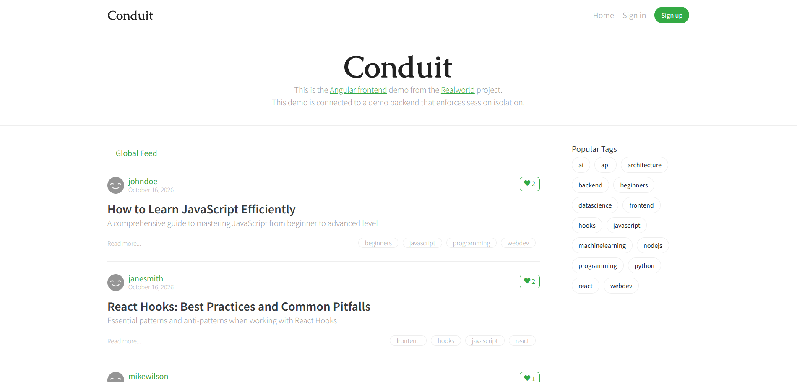
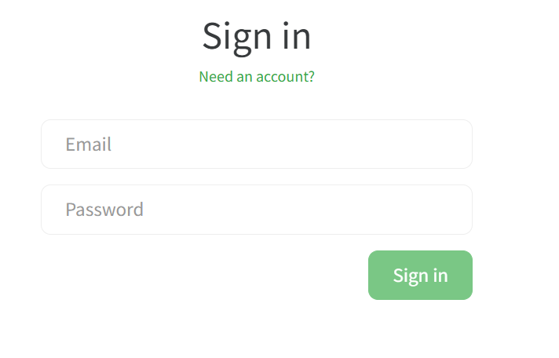
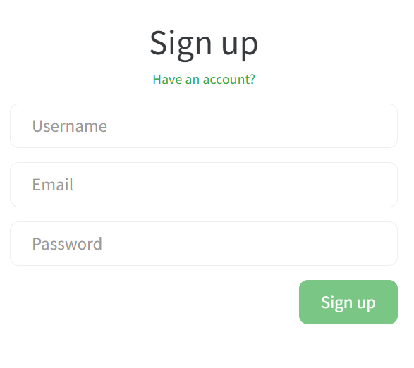
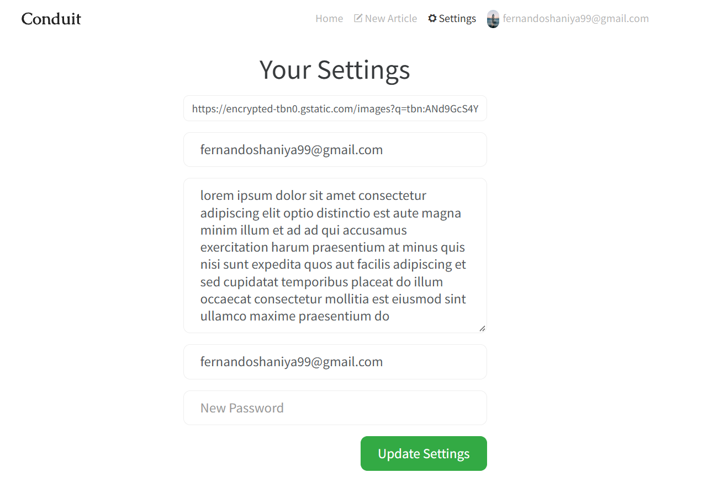
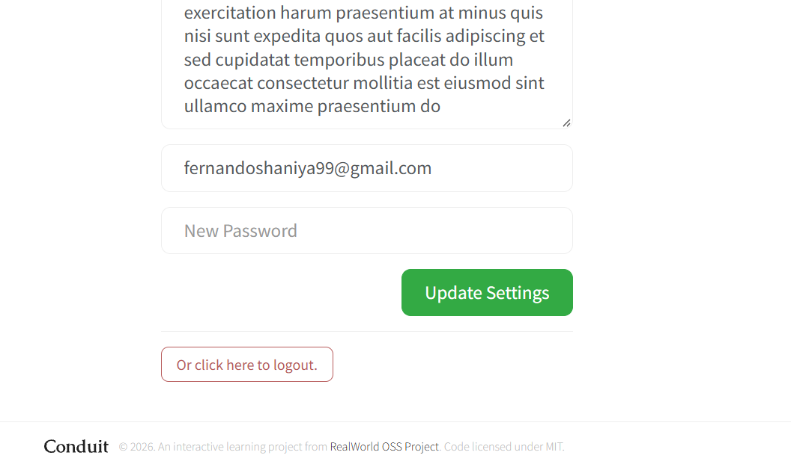
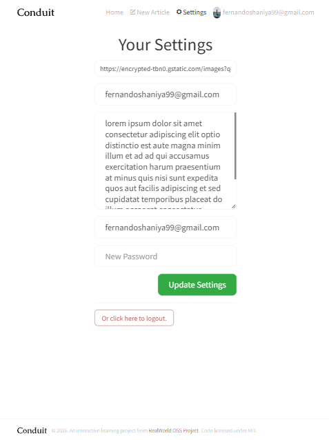
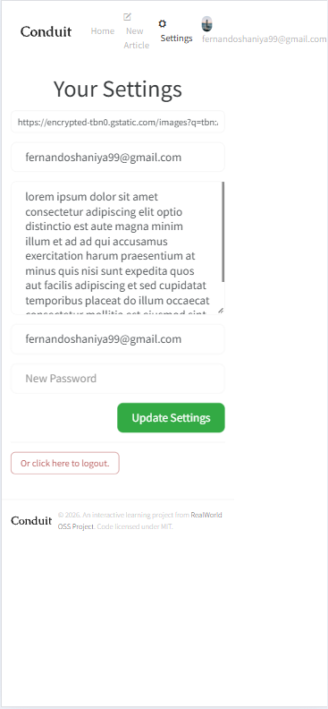
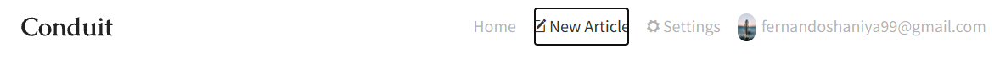
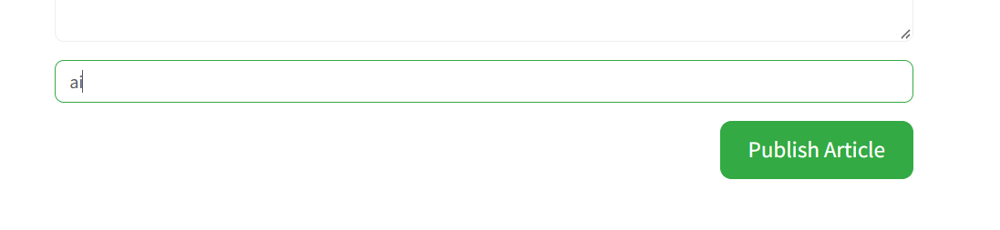

# Bug Report

This report documents bugs identified during manual testing of each component. Each bug is documented in the format of a JIRA work item for inclusion in a sprint.

---

Issue summary: 

- Issue Type: Bug
- Severity: Blocker, Critical, Major, Minor
- Priorty: LOW , MEDIUM , HIGH
- Labels:
- Component:
- Enviroment / Url:
- Browser / Device:
- User Role / Status:

Detailed Description:

Preconditions:

Steps:

Expected Results:

Actual Results:

Attachments:

---

Issue ID: 001

Issue summary: Low-contrast typography, misaligned favorite buttons, and unformatted tag styling across the article feed and sidebar.

- Issue Type: Bug
- Severity: Minor
- Priorty: LOW
- Labels: UI, Typography, Accessibility, Alignment, Data-Formatting
- Component: Global Feed / Article List / Sidebar Popular Tags
- Enviroment / Url: https://demo.realworld.show/
- Browser / Device: Google Chrome / Desktop
- User Role / Status: Any User

Detailed Description:
Multiple distinct UI and data-formatting issues are present on the home page:
1. **Typography Contrast:** The "Read more...", article tags, and publish dates utilize an excessively light grey color, failing to provide sufficient contrast against the background and making them difficult to read.
2. **Button Alignment:** The heart icon and numerical count inside the favorite button on article cards are vertically misaligned.
3. **Tag Formatting & Spelling:** Several tags in the article cards and the "Popular Tags" sidebar contain incorrect spellings, lack proper spacing/punctuation, and are not capitalized (e.g., `machinelearning` instead of "Machine Learning", `datascience` instead of "Data Science", `api` instead of "API", `ai` instead of "AI", `nodejs` instead of "Node.js", and `webdev` instead of "Web Dev").

Preconditions:
1. User navigates to the Conduit application home page (`https://demo.realworld.show/`).
2. The Global Feed and Popular Tags sidebar are fully loaded.

Steps:
1. Inspect the article metadata row to check the publish date text color and weight.
2. Inspect the "Read more..." text and individual pill tags under article previews for contrast.
3. Check the alignment of the heart icon and counter inside the article favorite buttons.
4. Review the "Popular Tags" sidebar and article tags for spelling, capitalization, and formatting errors.

Expected Results:
- Publish dates, "Read more..." links, and tag text should use a stronger, high-contrast light grey color for readability.
- The heart icon and numerical count within favorite buttons should be properly centered and vertically aligned.
- All tags should be capitalized, correctly spaced, properly punctuated, and accurately spelled (e.g., "Machine Learning", "Data Science", "API", "AI", "Node.js", "Web Dev").

Actual Results:
- Text elements like publish dates, "Read more...", and tags render in a faint light grey that is hard to see.
- The favorite button icon and counter are visibly misaligned.
- Tags appear in unformatted, lowercase, concatenated strings without proper casing or punctuation.

Attachments:

---

Issue ID: 002

Issue summary: Article tags overflow into adjacent articles and across dividers in the tablet viewport due to insufficient spacing and padding.

- Issue Type: Bug
- Severity: Major
- Priorty: HIGH
- Labels: UI, Responsive-Design, Layout, Overflow, Padding
- Component: Global Feed / Article List / Article Card Tags
- Enviroment / Url: [Conduit](https://demo.realworld.show/)
- Browser / Device: Google Chrome / Tablet Viewport (ipad mini)
- User Role / Status: Any User

Detailed Description:
When viewing the application on a tablet-sized viewport, the interactive category chips/tags displayed at the bottom right of each article card overflow their container. Instead of staying contained within the respective article's padding box, the tags spill over the horizontal divider line and overlap into the content or whitespace of the subsequent article in the feed. Increasing the internal padding and container bounds will properly contain the tags.

Preconditions:
1. User navigates to the [Conduit](https://demo.realworld.show/) application home page.
2. Viewport is resized or simulated to a tablet resolution where horizontal space causes tag wrapping.
3. Articles with multiple tags are rendered in the Global Feed.

Steps:
1. Resize the browser window to a standard tablet width.
2. Scroll through the article list in the Global Feed.
3. Inspect the bottom of individual article cards where the tag pills are aligned.
4. Observe the positioning of the tags relative to the bottom border/divider separating each article entry.

Expected Results:
- Article tags should remain fully contained within their respective article card bounds.
- Adequate padding should be maintained around and below the tags, ensuring they never cross or overlap the article divider line.

Actual Results:
- Tags overflow downwards past the article boundary and encroach onto the divider line and adjacent article content.

Attachments:

---

Issue summary: Missing article margins, lack of spacing, persistent horizontal divider in popular tags, and suboptimal tag section placement.

- Issue Type: Bug
- Severity: Major
- Priorty: HIGH
- Labels: UI, Layout, Spacing, Margins, Responsive-Design
- Component: Global Feed / Article List / Popular Tags Sidebar
- Enviroment / Url: [Conduit](https://demo.realworld.show/)
- Browser / Device: Google Chrome / Mobile (iphone 16)
- User Role / Status: Any User

Detailed Description:
Multiple layout and structural issues affect the readability and spacing of the page:
1. Article cards lack adequate outer margins and side spacing, causing them to crowd each other and the screen edges.
2. A horizontal divider line remains present inside the "Popular Tags" section.
3. The "Popular Tags" section is positioned below the articles rather than being accessible near the top of the page before the article list.

Preconditions:
1. User navigates to the [Conduit](https://demo.realworld.show/) application home page.
2. Global Feed articles and the Popular Tags section are loaded.

Steps:
1. Observe the spacing between individual article cards in the feed and their distance from the screen edges.
2. Inspect the "Popular Tags" section container for unwanted horizontal divider lines.
3. Check the placement of the "Popular Tags" section relative to the top of the page and the article list.

Expected Results:
- Proper margins and spacing should be applied between each article card and on the sides of the viewport.
- The horizontal divider line should be removed from the popular tags section.
- The popular tags section should be relocated to the top of the page, appearing before the main article list for improved accessibility and user flow.

Actual Results:
- Articles have non-existent outer margins, resulting in a cramped layout with insufficient spacing between cards and on the sides.
- A horizontal divider line is still rendered in the popular tags section.
- The popular tags section appears at the bottom instead of being accessible at the top of the page ahead of the articles.

Attachments:

---

Issue ID: 004

Issue summary: Missing form labels, placeholder-only inputs, global error placement, lack of inline field validation, missing password visibility toggle, uncentered submit button, and suboptimal copy.

- Issue Type: Bug
- Severity: Major
- Priorty: HIGH
- Labels: UI, Forms, Accessibility, Validation, UX-Writing
- Component: Sign In Form / Authentication
- Enviroment / Url: [Sign in](https://demo.realworld.show/login)
- Browser / Device: Google Chrome / Desktop
- User Role / Status: Unauthenticated / Guest User

Detailed Description:
The sign-in form suffers from several usability and accessibility shortcomings:
1. Input fields rely solely on disappearing placeholders without persistent labels, and required fields lack asterisk indicators.
2. Error messages are generically displayed at the top of the form rather than inline below each respective input with clear messaging ("The email is required and the email is invalid", and equivalent for the password).
3. The password field lacks a visibility toggle icon to show/hide input characters.
4. The "Sign in" action button is uncentered.
5. The secondary prompt copy ("Need an account?") features suboptimal wording.

Preconditions:
1. User navigates to the [Sign in](https://demo.realworld.show/login) page.

Steps:
1. Inspect the email and password input fields to check for explicit labels and required asterisks.
2. Click into an input field and observe placeholder behavior while typing.
3. Trigger validation errors and check where error messages are rendered.
4. Verify the presence of a password visibility toggle icon.
5. Check the alignment of the "Sign in" button and evaluate the wording of the account registration prompt.

Expected Results:
- Form fields should have clear persistent labels with required asterisks, remaining informative even after typing begins.
- Specific inline error messages ("The email is required and the email is invalid", etc.) should appear directly below their respective input fields.
- A password visibility toggle icon should be integrated into the password field.
- The "Sign in" button should be centered.
- Prompt text should feature improved, user-friendly wording.

Actual Results:
- Inputs use disappearing placeholders without labels or required asterisks.
- Error messages are grouped at the top of the form instead of below the specific fields, and messaging lacks clarity.
- No password visibility icon is available.
- The "Sign in" button is not centered, and account prompt copy is suboptimal.

Attachments:

---

Issue ID: 005

Issue summary: Missing form labels, placeholder-only inputs, global error placement, lack of inline field validation, missing password visibility toggle, uncentered submit button, suboptimal sign-in prompt copy, and missing confirm password field on the Sign Up page.

- Issue Type: Bug
- Severity: Major
- Priorty: HIGH
- Labels: UI, Forms, Accessibility, Validation, UX-Writing
- Component: Sign Up Form / Authentication
- Enviroment / Url: [Sign up](https://demo.realworld.show/register)
- Browser / Device: Google Chrome / Mobile / Viewport
- User Role / Status: Unauthenticated / Guest User

Detailed Description:
The sign-up form (`[Sign up](https://demo.realworld.show/register)`) shares the same structural and usability issues as the sign-in form, along with an additional missing field requirement:
1. Input fields (Username, Email, Password) rely solely on disappearing placeholders without persistent labels, and required fields lack asterisk indicators.
2. Error messages are generically displayed at the top of the form rather than inline below each respective input with clear messaging ("The email is required and the email is invalid", and equivalent for the password/username).
3. The password field lacks a visibility toggle icon to show/hide input characters.
4. The "Sign up" action button is uncentered.
5. The secondary prompt copy ("Have an account?") features suboptimal wording.
6. A **Confirm Password** field is missing and needs to be added to ensure password accuracy during registration.

Preconditions:
1. User navigates to the [Sign up](https://demo.realworld.show/register) page.

Steps:
1. Inspect the username, email, and password input fields to check for explicit labels, required asterisks, and the missing confirm password field.
2. Click into any input field and observe placeholder behavior while typing.
3. Trigger validation errors and check where error messages are rendered.
4. Verify the presence of a password visibility toggle icon.
5. Check the alignment of the "Sign up" button and evaluate the account prompt copy.

Expected Results:
- Form fields should have clear persistent labels with required asterisks (including a new Confirm Password field), remaining informative even after typing begins.
- Specific inline error messages should appear directly below their respective input fields.
- A password visibility toggle icon should be integrated into both password fields.
- The "Sign up" button should be centered.
- Prompt text should feature improved, user-friendly wording.

Actual Results:
- Inputs use disappearing placeholders without labels or required asterisks, and no confirm password field exists.
- Error messages are grouped at the top of the form instead of below specific fields.
- No password visibility icon is available.
- The "Sign up" button is not centered, and account prompt copy is suboptimal.

Attachments:

---

Issue ID: 006

Issue summary: Inconsistent input and text sizing, avatar distortion on non-1:1 image URLs, missing profile dropdown menu, and single logout access point on the Settings page.

- Issue Type: Bug
- Severity: Major
- Priorty: HIGH
- Labels: UI, Typography, Responsive-Design, Navigation, UX
- Component: Settings Page / Navigation Bar / Profile Menu
- Enviroment / Url: [Settings](https://demo.realworld.show/settings)
- Browser / Device: Google Chrome / Desktop
- User Role / Status: Authenticated / Logged-in User

Detailed Description:
Multiple visual and navigational inconsistencies exist on the [Settings](https://demo.realworld.show/settings) page and navigation bar:
1. Input field sizes and text sizes vary inconsistently across the settings form, lacking a standardized body text size.
2. When a profile image URL that is not in a 1:1 aspect ratio is uploaded, the avatar in the navigation bar improperly shrinks/distorts from the sides.
3. Clicking on the profile section in the navigation bar currently lacks a dropdown menu; it should open a menu containing distinct options for Profile, Settings, and Logout.
4. There are multiple ways to access logout (e.g., via the profile dropdown menu in addition to the existing footer logout link), whereas currently only a single logout mechanism exists.

Preconditions:
1. User is logged into the application and navigates to the [Settings](https://demo.realworld.show/settings) page.

Steps:
1. Inspect the input fields and text elements on the settings form to check for consistency in sizing and body text styling.
2. Update the profile picture URL with a non-1:1 aspect ratio image and observe the avatar rendering in the navigation bar.
3. Click on the profile section in the navigation bar and verify whether a dropdown menu appears.
4. Review available logout options across the page versus the navigation bar.

Expected Results:
- All input fields and text elements should follow a standardized common body text size and consistent dimensions.
- Non-1:1 profile images should be properly cropped, contained, or scaled (e.g., using object-fit) to prevent avatar distortion in the navigation bar.
- Clicking the profile section in the navigation bar should open a dropdown menu featuring separate options for Profile, Settings, and Logout.
- Multiple intuitive ways to log out (such as in the navbar dropdown and footer) should be provided.

Actual Results:
- Input sizes and font sizes are inconsistent throughout the settings form.
- Non-1:1 images cause the navbar avatar to shrink and distort from the sides.
- No dropdown menu opens when clicking the profile section in the navigation bar.
- Only a single logout link is available at the bottom of the settings page.

Attachments:

---

Issue No: 007

Issue summary: Missing dedicated password reset form, suboptimal logout button placement and wording.

- Issue Type: Bug
- Severity: Major
- Priorty: HIGH
- Labels: UI, UX, Security, Authentication, Forms
- Component: [Settings](https://demo.realworld.show/settings) Page / Authentication
- Enviroment / Url: [Settings](https://demo.realworld.show/settings)
- Browser / Device: Google Chrome / Desktop
- User Role / Status: Authenticated / Logged-in User

Detailed Description:
The current implementation for updating passwords and logging out within the [Settings](https://demo.realworld.show/settings) page has several UX deficiencies:
1. Password modification relies on a single "New Password" input field embedded inside the main profile settings form rather than a dedicated, secure password reset flow (which should either require entering the email address to trigger a reset or validating the old password alongside a confirmed new password).
2. The logout button/link currently uses weak wording ("Or click here to logout.") and is poorly placed at the bottom of the page, making it difficult to locate.

Preconditions:
1. User is authenticated and navigates to the [Settings](https://demo.realworld.show/settings) page.

Steps:
1. Locate the password section on the [Settings](https://demo.realworld.show/settings) page.
2. Review the current input fields used for changing passwords.
3. Locate the logout link at the bottom of the form and evaluate its wording and placement.

Expected Results:
- A separate, dedicated form or clearly demarcated section should be provided for resetting passwords, requiring either:
  - Entering the registered email address to receive a password reset link, OR
  - Entering the current (old) password alongside a new password and a confirmation field.
- The logout action should feature prominent placement (such as in the navigation bar dropdown menu) and professional, clear wording.

Actual Results:
- Only a single "New Password" field exists inside the main settings form without old-password validation or email-based confirmation.
- The logout link is awkwardly phrased as "Or click here to logout." and is buried at the bottom of the page.

Recommended Wording for Logout:
- **Button/Link Text:** "Log Out" or "Sign Out"
- **Action Confirmation (if applicable):** "Are you sure you want to log out?"

Attachments:

---

Issue IDL 008

Issue summary: Narrow form container width and lack of proper padding/margins on tablet viewports.

- Issue Type: Bug
- Severity: Major
- Priorty: HIGH
- Labels: UI, Responsive-Design, Layout, Tablet, Spacing
- Component: Settings Form / Container
- Enviroment / Url: [Settings](https://demo.realworld.show/settings)
- Browser / Device: Google Chrome / Tablet / iPad Viewport
- User Role / Status: Authenticated / Logged-in User

Detailed Description:
When accessing the [Settings](https://demo.realworld.show/settings) page on a tablet or iPad-sized screen, the main form container is constrained to an overly narrow column, failing to utilize available screen real estate effectively and creating an unbalanced layout with insufficient surrounding margins.

Preconditions:
1. User is authenticated and navigates to the [Settings](https://demo.realworld.show/settings) page.
2. Viewport is set to a tablet/iPad width.

Steps:
1. Open the [Settings](https://demo.realworld.show/settings) page on a tablet viewport.
2. Observe the width of the form container relative to the screen edges.

Expected Results:
- The form container should expand proportionally to provide a comfortable width and appropriate side margins on tablet viewports.

Actual Results:
- The form container remains too narrow, leaving excessive dead space on the sides.

Attachments:

---

Issue ID: 009

Issue summary: Navigation items are unclear and cramped on mobile/iPhone 16 viewports due to lack of a collapsible hamburger menu.

- Issue Type: Bug
- Severity: Major
- Priorty: HIGH
- Labels: UI, Responsive-Design, Navigation, Mobile, Accessibility
- Component: Navigation Bar / Header
- Enviroment / Url: [Settings](https://demo.realworld.show/settings)
- Browser / Device: Google Chrome / iPhone 16 / Mobile Viewport
- User Role / Status: Authenticated / Logged-in User

Detailed Description:
When viewing the application on smaller mobile viewports such as the iPhone 16, the standard top navigation items appear cramped, unclear, or partially clipped. To improve usability and save screen space, a hamburger menu icon should be introduced, allowing users to tap and expand the navigation items cleanly into a vertical or overlay menu.

Preconditions:
1. User is logged into the application and accessing the site via an iPhone 16 or simulated mobile viewport (e.g., on `[Settings](https://demo.realworld.show/settings)`).

Steps:
1. Open the application on an iPhone 16 or mobile-sized browser window.
2. Observe the top navigation bar layout and examine how the navigation links render.
3. Check for the presence of a responsive hamburger menu toggle.

Expected Results:
- On mobile viewports like the iPhone 16, navigation items should be hidden behind a clear, accessible hamburger menu icon.
- Tapping the menu icon should open a neatly structured dropdown or overlay menu displaying all navigation options clearly.

Actual Results:
- Navigation items remain displayed in a restricted space or become unclear without a collapsible mobile menu.

Attachments:

---

Issue ID: 010

Issue summary: Suboptimal navigation item highlight states lacking sufficient horizontal padding and interactive hover/active shadow effects.

- Issue Type: Bug
- Severity: Minor
- Priorty: LOW
- Labels: UI, Navigation, Styling, Hover-State, Accessibility
- Component: Navigation Bar / Header Links
- Enviroment / Url: [Editor](https://demo.realworld.show/editor)
- Browser / Device: Google Chrome / Desktop
- User Role / Status: Authenticated / Logged-in User

Detailed Description:
The interactive state styling for items within the top navigation bar (`[Home](https://demo.realworld.show)`, `[New Article](https://demo.realworld.show/editor)`, `[Settings](https://demo.realworld.show/settings)`) is currently insufficient. Specifically, navigation links lack adequate horizontal padding around the text and do not provide a visual shadow effect or depth cue when hovering or clicking/active, making the current page indication and interactive feedback feel flat.

Preconditions:
1. User is authenticated and viewing the application header on any page (e.g., [Editor](https://demo.realworld.show/editor)).

Steps:
1. Hover the cursor over the navigation items in the top header.
2. Click on a navigation item and observe the active/focus styling.
3. Inspect the padding around the navigation link text and check for any shadow or elevation changes.

Expected Results:
- Navigation items should feature increased horizontal padding to enlarge the interactive clickable area.
- Hovering or clicking a navigation item should apply a clear shadow effect or visual elevation to provide immediate feedback on user interaction.

Actual Results:
- Navigation items have restricted horizontal padding and show no shadow or elevation change upon hover or click.

Attachments:

---

Issue ID: 011

Issue summary: Inconsistent input sizes and typography, missing persistent labels, lack of required asterisks, and misaligned validation error placement across the editor form.

- Issue Type: Bug
- Severity: Major
- Priorty: HIGH
- Labels: UI, Forms, Accessibility, Validation, Typography
- Component: [New Article](https://demo.realworld.show/editor) Form / Editor
- Enviroment / Url: [Editor](https://demo.realworld.show/editor)
- Browser / Device: Google Chrome / Desktop
- User Role / Status: Authenticated / Logged-in User

Detailed Description:
The article creation form on the [Editor](https://demo.realworld.show/editor) page has several styling and usability flaws:
1. Input field dimensions (heights, widths) and text sizes vary inconsistently across the form fields ("Article Title", "What's this article about?", "Write your article", "Enter tags"), lacking a standardized body text size.
2. Form fields rely solely on disappearing placeholders without persistent labels.
3. Required input fields lack required asterisks (`*`) to denote mandatory entry.
4. Validation error messages are not positioned correctly at the bottom of each respective input field.

Preconditions:
1. User is logged in and navigates to the [Editor](https://demo.realworld.show/editor) page.

Steps:
1. Inspect the input fields and text areas on the [Editor](https://demo.realworld.show/editor) page to check for consistent sizing and standard body font styles.
2. Check for persistent labels and required asterisks above or beside each input.
3. Trigger submission with empty required fields and observe where validation error messages appear.

Expected Results:
- All input fields and text elements should have consistent sizing and adhere to a standard body text style.
- Every input field should feature a clear, persistent label with an asterisk (`*`) indicating required fields.
- Validation error messages should be displayed directly beneath each specific input field for clear guidance.

Actual Results:
- Input sizes and text styles are inconsistent across the form.
- Inputs lack persistent labels and required asterisks.
- Error messages are either missing or incorrectly positioned.

Attachments:

---

Issue No: 012

Issue summary: Missing Markdown preview mode and toolbar formatting features (such as icons for headings, dividers, and formatting tools) in the article editor.

- Issue Type: Feature Request / Bug
- Severity: Major
- Priorty: HIGH
- Labels: UI, Editor, Markdown, Preview, Feature-Request
- Component: [New Article](https://demo.realworld.show/editor) Form / Markdown Editor
- Enviroment / Url: [Editor](https://demo.realworld.show/editor)
- Browser / Device: Google Chrome / Desktop
- User Role / Status: Authenticated / Logged-in User

Detailed Description:
The current article editor page (`[New Article](https://demo.realworld.show/editor)`) provides a raw text area for drafting articles in markdown without a visual preview mode to check rendered output before publishing. Additionally, the editor lacks an action toolbar with formatting icons (such as buttons for headings, bold/italic text, lists, and horizontal dividers) to assist users in structuring their content efficiently.

Preconditions:
1. User is authenticated and navigates to the [New Article](https://demo.realworld.show/editor) page.

Steps:
1. Observe the formatting interface above or around the "Write your article (in markdown)" text area.
2. Check for the presence of an editor toolbar (containing icons for headings, dividers, bolding, etc.).
3. Check for a toggle or split-pane view allowing users to preview rendered Markdown output.

Expected Results:
- A formatting toolbar should be added above the editor text area, providing quick-action icons to insert headings, dividers, bold text, lists, and links.
- A dedicated **Preview Mode** (or side-by-side split view) should be available so users can preview how their Markdown content will render prior to publishing.

Actual Results:
- The editor consists only of a plain text area without any formatting toolbar icons or a preview mode.

---

Issue No: 13

Issue summary: Missing autocomplete functionality for tags with existing tag lists and lack of automatic text formatting logic.

- Issue Type: Feature Request / Bug
- Severity: Minor
- Priorty: MEDIUM
- Labels: UI, UX, Tags, Autocomplete, Data-Formatting
- Component: [New Article](https://demo.realworld.show/editor) Form / Tags Input
- Enviroment / Url: [Editor](https://demo.realworld.show/editor)
- Browser / Device: Google Chrome / Desktop
- User Role / Status: Authenticated / Logged-in User

Detailed Description:
The "Enter tags" input field on the article editor page (`[New Article](https://demo.realworld.show/editor)`) currently requires manual typing without assistance or validation. It lacks an autocomplete dropdown containing the full list of existing tags to help users select previously used categories. Additionally, it lacks automatic text-formatting logic to ensure tags follow proper capitalization, spacing, and punctuation rules (e.g., auto-formatting "machinelearning" to "Machine Learning", "nodejs" to "Node.js", or "api" to "API").

Preconditions:
1. User is authenticated and navigates to the [New Article](https://demo.realworld.show/editor) page.

Steps:
1. Click into the "Enter tags" input field.
2. Type a few characters and observe whether an autocomplete suggestion list of existing tags appears.
3. Enter unformatted or lowercase tag text (e.g., "machine learning" or "nodejs") and check if the system automatically applies proper formatting, casing, and punctuation.

Expected Results:
- An autocomplete dropdown should appear as the user types, displaying matching existing tags from the system to select from.
- Input logic should automatically format tags to follow correct casing, spacing, and punctuation standards (e.g., proper capitalization and correct spelling for terms like "Node.js", "Machine Learning", and "API").

Actual Results:
- The tag input operates as a plain text field without any autocomplete suggestions or automatic text-formatting logic.

Attachments:

